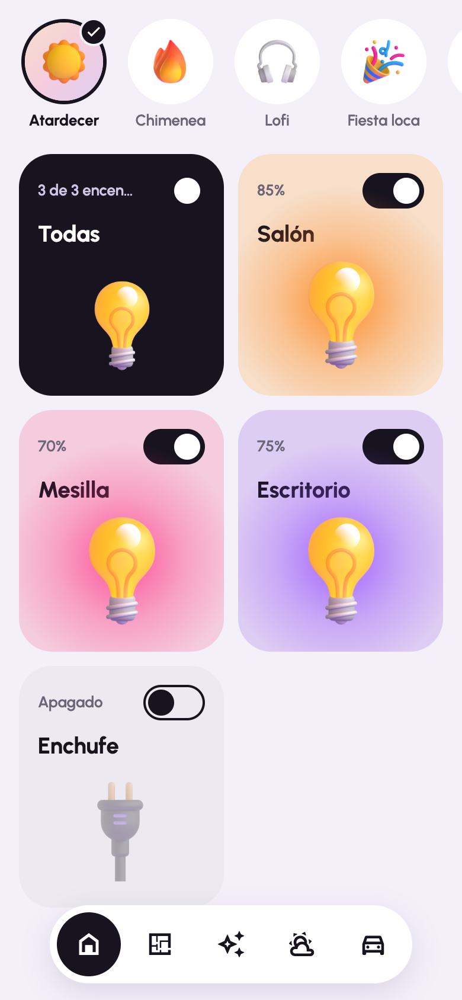
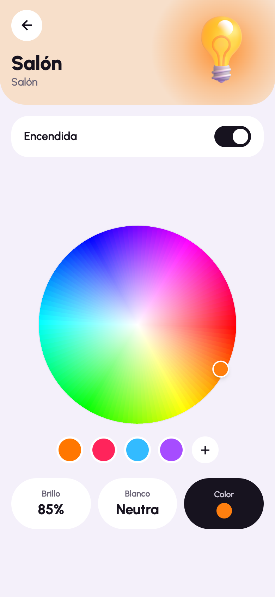
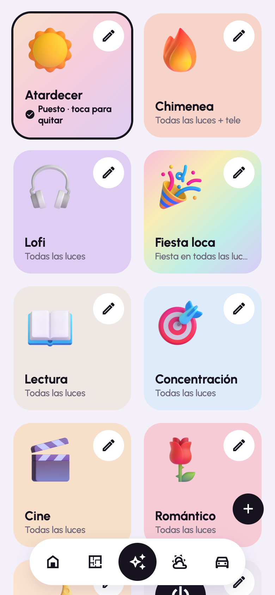
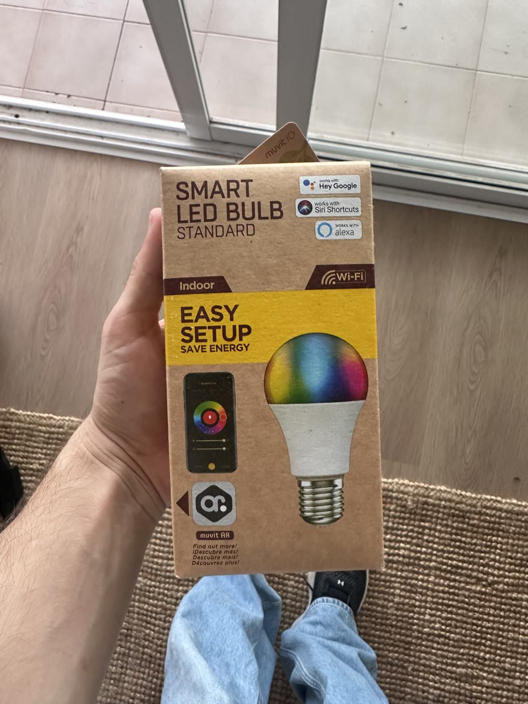
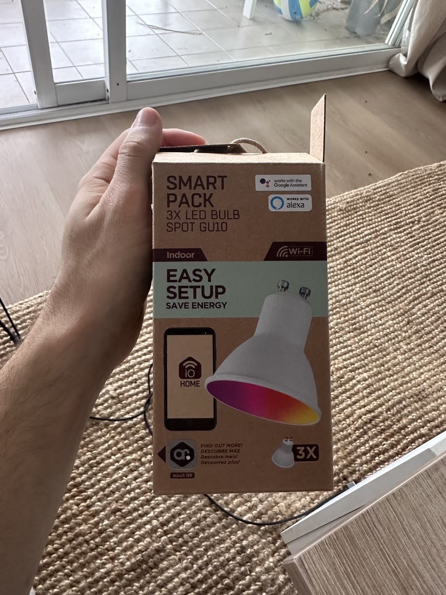
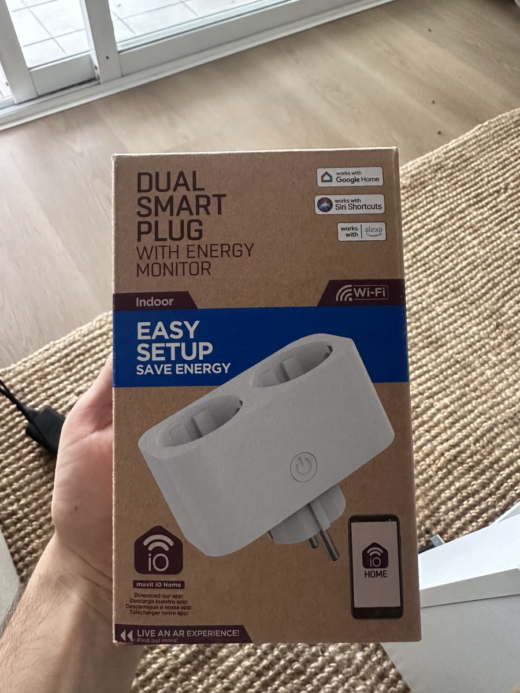
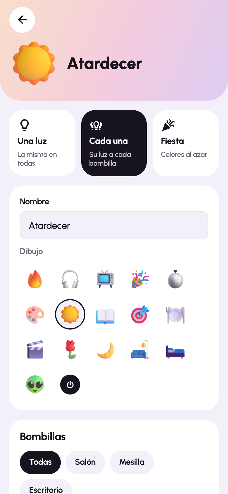
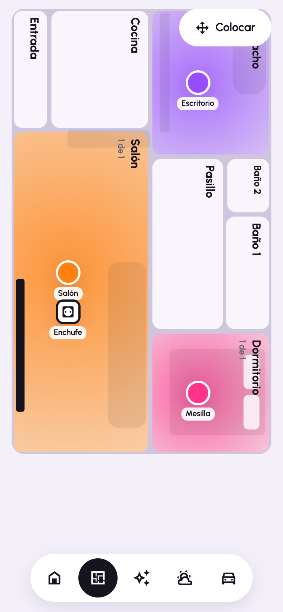
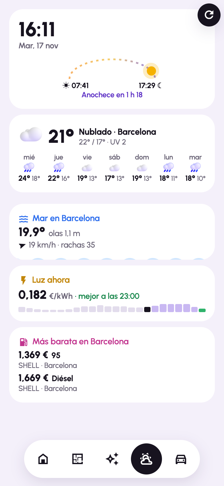
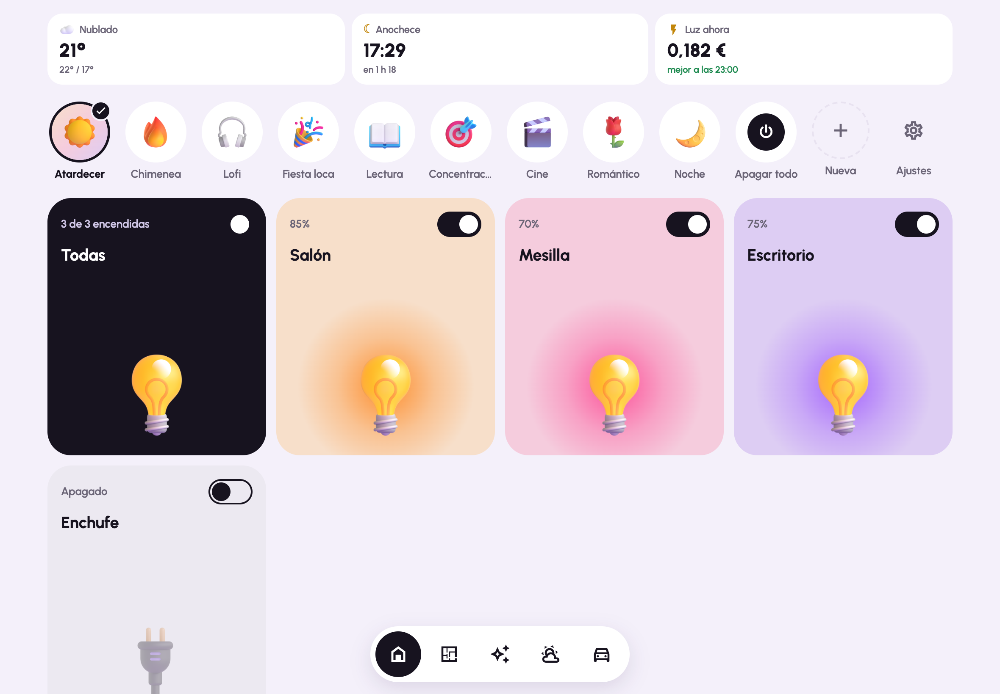

<p align="center">
  
</p>

# MarsianApp

### The app I made for my home's lights, by [Marc Aparisi Rull](https://github.com/MarcAparisiTFG)

MarsianApp is an app I designed and programmed myself, for my own home: the lights, the modes, the house plan, the
"before going out" screen, everything. It isn't a template or a copy of another app. Every screen, every
interaction and every line of code here is mine, made for the way we live at home.

Free to use and build on, **as long as you credit me** ([see the license](#license)).

<p align="center">
  
  
  
</p>

## Why I made it

A huge number of affordable smart bulbs are **Tuya** bulbs under another brand, and they come with Tuya's closed
app (or a rebranded copy of it): you need their account and their cloud, and you can only do what the app lets you
do. You can't build anything of your own on top of it.

For a while I'd been looking for lights that were open, that I could program myself. Not because I needed to, but
because I really wanted to: I wanted the lights at home to work exactly how I imagined them. In the end I went with
the **Muvit iO** bulbs (MIOBULB008), which are Tuya inside, and set out to open them.

So I studied how these devices talk on the local network: Tuya's local protocols **3.3** (bulbs) and **3.4**
(plugs), how they encrypt each message with the device's own key, and what each of their data points means. Once
that was clear, I wrote my own implementation in TypeScript, tested byte for byte, and built everything else on
top of it: a small bridge that runs at home, HomeKit for Siri, and the app itself. After getting each
bulb's key once, there's no Tuya app, no cloud and no account in the loop: the phone talks to the bulb over our own
Wi-Fi in a few milliseconds.

### What I tested it with

These are the Muvit iO devices I bought and use at home with MarsianApp:

| Smart LED bulb (E27) | Smart pack: 3× GU10 spots | Dual smart plug with energy monitor |
| --- | --- | --- |
|  |  |  |
| Tuya protocol 3.3 | Tuya, same Muvit iO app | Tuya protocol 3.4 |

## Made for my home, open for yours

I made MarsianApp for me and for my home. That's why it has things no generic app has: our modes, the floor plan
with each light in its room, a wall tablet, and a "before going out" screen with the sun, the weather, the sea, the
traffic to the places we go and the price of electricity and fuel.

But I built it to be adaptable, and I'm sharing the source code so you can use it with your own Tuya bulbs: change
your town in one file, add your bulbs, and make it yours. Or take only the protocol part and build a completely
different app for your lights. The tutorial below explains everything, step by step.

> The app's interface and the code comments are in Spanish, because it's the app we use at home. Everything you need
> to set it up is in English below.

## What it does

- **Lights**: on/off, brightness, warm↔cold white and the full RGB wheel, per bulb or all at once. Dragging is live.
- **Modes**: one tap sets several bulbs (and plugs) at once: "Cinema", "Reading", "Romantic"… Tap again and every
  bulb goes back to how it was. Three kinds: one light for all, each bulb its own, or **party** (the bulb itself
  cycles random colours, so it keeps going with the app closed).
- **Smart plugs** (Tuya protocol 3.4), including double plugs and power readings.
- **House plan**: drag each light onto a floor plan and tap it there.
- **Siri and Apple Home**: the bridge publishes every bulb and every mode to HomeKit ("Hey Siri, turn on Cinema mode").
  There are also iOS App Intents and Android home-screen shortcuts per mode.
- **Philips TV (optional)**: a mode can open YouTube/Netflix/Disney+… and match the Ambilight to the lights.
- **Home dashboard (optional)**: weather, sea, weather alerts, cheapest fuel nearby and electricity price, plus an
  Android widget for a wall tablet.
- **Places and traffic (optional)**: how long it takes right now to drive to the places you go to, on a live
  traffic map (TomTom free tier, or OSRM without traffic).

## Screenshots

| Home | One bulb | Modes | Mode editor |
| --- | --- | --- | --- |
|  |  |  |  |

| House plan | Before going out | Wall tablet |
| --- | --- | --- |
|  |  |  |

These are the demo bulbs: open the web app with `?demo` (step 4 below) to try it without any bulbs.

## How it works

```
 phone / tablet / browser                    your Wi-Fi                     bulbs and plugs
┌──────────────────────┐   HTTP :8787   ┌─────────────────┐   TCP :6668   ┌──────────────┐
│ MarsianApp (Expo)    │ ─────────────▶ │ bridge (Node)   │ ────────────▶ │ Tuya bulb    │
│ web, Expo Go, native │                │ tools/bridge.ts │  AES, local   │ Tuya plug    │
└──────────────────────┘                │ + HomeKit       │      key      └──────────────┘
          │  (native build can also talk to the bulbs directly) ───────────────▲
```

- **The protocol** (`src/tuya/`): Tuya local protocol **3.3** (AES-128-ECB with the device's `local_key` + CRC32) for
  the bulbs and **3.4** (session-key handshake + HMAC-SHA256) for the plugs. Pure TypeScript, tested byte for byte
  against packets generated with [tinytuya](https://github.com/jasonacox/tinytuya) (`tools/python/`).
- **The bridge** (`tools/bridge.ts`): a bulb accepts only one connection at a time, so one small server at home keeps
  that connection and everyone else asks it. It also runs HomeKit and keeps the shared modes. Keys never leave it.
- **The app** (`src/`): Expo + expo-router. In a browser or Expo Go it goes through the bridge. A native build has its
  own TCP/UDP sockets and can reach the bulbs directly; if the bridge is on, it still goes through it.
- **Demo mode**: with no bridge and no native sockets the app shows simulated bulbs, so you can play with the UI first.

### The bulb's data points (DPS)

A Tuya v2 bulb is just a handful of numbered values. This is everything the app sends:

| DPS | Meaning | Values |
| --- | --- | --- |
| `20` | power | `true` / `false` |
| `21` | mode | `"white"`, `"colour"`, `"scene"` |
| `22` | white brightness | `10`–`1000` |
| `23` | colour temperature | `0` (warm) – `1000` (cold) |
| `24` | colour | HSV as 12 hex chars: `hhhhssssvvvv` (hue 0–360, sat and value 0–1000) |
| `25` | scene | scene number + up to 8 colours with change/fade times (see `partyScene` in `src/lightCore.ts`) |

For example, `{"20": true, "21": "colour", "24": "000003e803e8"}` is full-brightness red (hue `0000`, saturation and
value `03e8` = 1000). That's all a "smart" bulb is.

## Tutorial: from the box to your own app

### 0. What you need

- Tuya-based Wi-Fi bulbs (tested with the **Muvit iO** E27 bulb MIOBULB008, the GU10 spots and the dual smart
  plug shown above; any Tuya v2 bulb using DPS 20–25 should work),
  already added to the **Smart Life** or **Tuya Smart** app.
- A computer on the same Wi-Fi for the bridge (a Mac, a Linux box or a Raspberry Pi) with **Node.js 20+** and
  **Python 3**.
- A phone with **Expo Go**, or just a browser, to start.

### 1. Get your bulbs' local keys

The key is created when you pair the bulb, and Tuya only shows it through its developer cloud. You need it once.

1. Create a free account at [iot.tuya.com](https://iot.tuya.com) → **Cloud → Development → Create Cloud Project**.
   Choose the **data center of your Smart Life account** (e.g. Central Europe) and the "Smart Home" industry.
2. In the project: **Devices → Link App Account → Add App Account**, and scan the QR code with the Smart Life app
   (Me → the scan icon). Your bulbs appear in the list.
3. Note the project's **Access ID** and **Access Secret** (Overview tab).
4. In this repo's folder:

   ```bash
   python3 -m venv venv
   ```

   ```bash
   venv/bin/pip install tinytuya
   ```

   ```bash
   venv/bin/python -m tinytuya wizard
   ```

   Paste the Access ID/Secret, pick your region, and say yes to scanning the network. It writes **`devices.json`**
   with every device's `id`, `ip`, `key` and `version`.

`devices.json` is in `.gitignore`. **Never commit it**: anyone with a key can control that bulb on your network.

> Tip: give each bulb a fixed IP in your router. The app also looks for bulbs on the network (UDP 6666/6667) and
> updates IPs that change.

### 2. Tell it where home is

Open `src/home.ts` and change the example (Barcelona) to your town: coordinates, time zone, the sea point, the
weather-alert area and the fuel town. They are only used by the optional dashboard, places and widget.

Other things worth making yours:

- `src/defaults.ts`: the modes the app starts with.
- `src/plan.ts`: the floor plan (rooms are rectangles in plan units; the example is a generic flat).
- `src/global.css` and `src/theme.ts`: colours and fonts.

### 3. Start the bridge

```bash
npm install
```

```bash
npm run bridge
```

It prints your bulbs, the bridge's address on your network and a **6-digit code** (used in step 5). The first time it
also prints a **HomeKit QR code**: in the Home app on an iPhone, tap + → Add Accessory and scan it. Run it without
HomeKit with `NO_HOMEKIT=1 npm run bridge`, or on another port with `PORT=9000 npm run bridge`.

Check it from any browser: `http://<bridge-ip>:8787/bulbs`.

Keep it running (for example with `pm2`, a `launchd` agent or a `systemd` service) so HomeKit and the shared modes
always work.

### 4. Open the app

On the same computer:

```bash
npm run web
```

or, to use it on your phone with Expo Go:

```bash
npx expo start
```

and scan the QR code. Both find the bridge automatically (same machine as the dev server) and control the real bulbs.
Without the bridge you get demo bulbs, and `http://localhost:8081/?demo` forces the demo even when the bridge is
running.

### 5. Build the real app (optional)

Expo Go can't open raw TCP sockets, so the full app (direct control, widget, Siri intents, shortcuts) needs a
native build. Change `bundleIdentifier` / `package` in `app.json` to your own, then:

- **Android**: `npx expo run:android` with a phone plugged in, or an APK with EAS: `npx eas-cli init` and then
  `npx eas-cli build --profile preview --platform android`.
- **iPhone**: `npx expo run:ios --device` with your Apple developer team set in Xcode
  (`tools/install-iphone.sh` builds and installs a release build on a connected iPhone).

In the built app, go to **Ajustes → Traer del puente**, type the bridge's IP and the 6-digit code, and it copies all
your bulbs and plugs with their keys. (You can also paste the contents of `devices.json` in **Importar bombillas**.)
After 5 wrong codes the bridge stops accepting codes until it restarts.

### 6. Optional extras

- **Philips TV** (JointSpace API, tested on a 2023 Titan OS model): pair once with
  `TV_IP=192.168.1.x venv/bin/python -I tools/python/tv_pair.py request`, then `… grant <PIN>`.
  It writes `tv.json` next to `devices.json`; restart the bridge.
- **Live traffic**: get a free key at [developer.tomtom.com](https://developer.tomtom.com) and save it as
  `tomtom.json` → `{ "key": "…" }`. Without it, routes come from OSRM (no traffic).
- **Dashboard data**: weather and sea from [Open-Meteo](https://open-meteo.com) (worldwide, no key); alerts from
  [Meteoalarm](https://meteoalarm.org) (Europe); fuel and electricity prices are Spain-only public APIs. Set
  `fuelTown: null` in `src/home.ts` to hide fuel.
- **Android widget**: long-press the home screen → Widgets → MarsianApp.
- **Deep links**: `marsianapp://modo/<name>` turns a mode on (handy for NFC tags and automations).

## Make your own app with these lights

Everything you need to control a bulb fits in a few files. Start from `src/tuya/` and ignore the rest:

```ts
import net from 'node:net';
import { TuyaDevice, Connect } from './src/tuya/device';
import { setColour, setWhiteTemp } from './src/tuya/bulb';

const connect: Connect = (host, port, onConnect) => net.connect({ host, port }, onConnect) as never;
const bulb = new TuyaDevice('<id>', '<ip>', '<local_key>', connect);

await bulb.connect();
await bulb.setDps({ '20': true });           // on
await setColour(bulb, 0);                    // red (hue 0–360)
await setWhiteTemp(bulb, 20);                // warm white
console.log(await bulb.getStatus());
bulb.close();
```

`src/tuya/live-test.ts` does exactly that (on, white, red, green, blue…) with the first device in your `devices.json`:

```bash
npx tsx src/tuya/live-test.ts
```

From there it's yours: an HTTP endpoint for a Stream Deck, lights that follow your screen, a sunrise alarm, lights
that react to your CI… The bridge (`tools/bridge.ts`) shows how to share one connection between many clients, and
`src/lightCore.ts` has the colour maths and the scene format.

Useful pieces:

| File | What it is |
| --- | --- |
| `src/tuya/protocol33.ts`, `protocol34.ts` | Encode/decode Tuya local packets |
| `src/tuya/bulb.ts` | `setPower`, `setBrightness`, `setWhiteTemp`, `setColour` |
| `src/tuya/device.ts` | A connection to one device: handshake, heartbeat, `setDps`, `getStatus`, status pushes |
| `src/tuya/discoverCore.ts` | Find devices on the LAN from their UDP broadcasts |
| `src/lightCore.ts` | Look ↔ DPS, HSV hex, party scenes |
| `tools/bridge.ts` | The home server: one connection per device, HTTP API, live drag coalescing |
| `tools/homekit.ts` | Bulbs, plugs and modes as HomeKit accessories |

### Bridge HTTP API

| Method | Path | |
| --- | --- | --- |
| GET | `/bulbs`, `/plugs` | Devices (without keys) |
| GET | `/status/<id>` | Current DPS of a device |
| POST | `/dps/<id>` | Send DPS (JSON body), waits for the device |
| POST | `/live/<id>` | Send DPS while dragging: answers at once, only the latest one is sent |
| GET/POST | `/modes` | Shared modes; POST `/mode/<id>` toggles one |
| GET | `/export?code=123456` | Devices **with keys**, once, with the code the bridge prints |
| GET | `/dashboard`, `/trips`, `/traffic`, `/places` | Optional dashboard, routes and map |

The bridge is meant for your home network only: it has no login apart from the export code. Don't expose it to the
internet.

## Tests

```bash
npm test
```

The protocol tests compare against packets generated by tinytuya with fake keys (`tools/python/make_vectors*.py`).

## Credits

- [tinytuya](https://github.com/jasonacox/tinytuya), the reference for the Tuya local protocol.
- [HAP-NodeJS](https://github.com/homebridge/HAP-NodeJS) for HomeKit.
- 3D icons from [Microsoft Fluent Emoji](https://github.com/microsoft/fluentui-emoji) (MIT, see `assets/3d/`).
- Open-Meteo, OpenStreetMap / Photon / OSRM, TomTom, Meteoalarm, Red Eléctrica and the Spanish Ministry fuel API.

Not affiliated with Tuya, Muvit or Philips.

## License

**Free to use, with credit.** You can use this project, change it and build your own apps on it for free, but
anything you make or publish with it must visibly credit me, with my name and a link to this repo. For example, in
your README, your app's "About" screen, or the description of your post or video:

```
Based on MarsianApp by Marc Aparisi Rull
https://github.com/MarcAparisiTFG/local-tuya-bulbs
```

Don't present it as your own work, and give your version its own name and logo. The full terms are in
[LICENSE](LICENSE). This is not an OSI open-source license. © 2026 Marc Aparisi Rull. The MarsianApp name and logo
are mine.

Made by Marc Aparisi Rull. If you build something with it, I'd love to see it.
